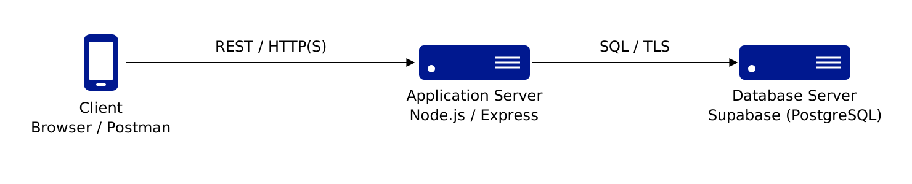
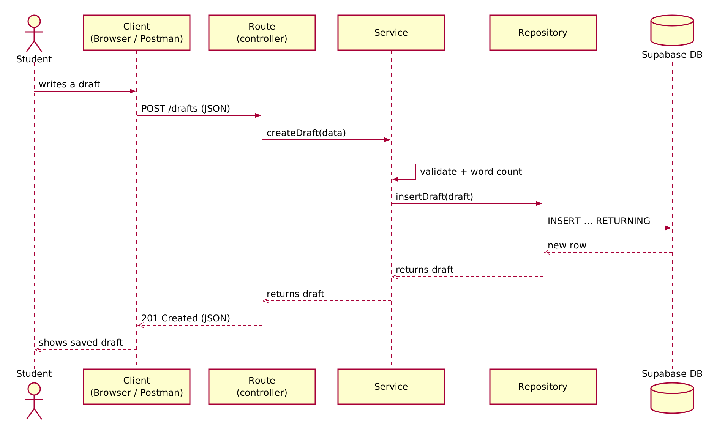

# Essay Drafts API

### A small layered REST API for saving essay drafts, built with Node.js, Express and PostgreSQL (Supabase).

Students can create, read, replace and delete writing drafts. The server validates every draft and calculates its word count itself.

This is a learning project: its goal is to show a clean **layered architecture** in Express (routes → service → repository → database), the same structure used in Spring Boot applications, with secure defaults from the start.

[Architecture](#architecture) · [API](#api) · [Project structure](#project-structure) · [Security](#security-and-privacy) · [Getting started](#getting-started) · [Spring Boot comparison](#coming-from-spring-boot)

## Architecture

### Physical architecture



| Component | Technology | Responsibility |
|---|---|---|
| Client | Browser, Postman, or any HTTP client | Sends REST requests with JSON bodies |
| Application server | Node.js + Express | REST API, validation, business rules |
| Database server | PostgreSQL hosted on Supabase | Stores the drafts (source of truth) |

The application is a **monolith**: the routes, service and repository layers are packaged and deployed together as one Express application. The database runs on a separate server. The API is **stateless**: every request carries everything the server needs, and all data lives in the database.

### Request flow: creating a draft



1. The client sends `POST /drafts` with a JSON body.
2. The **route** reads the request and calls the service.
3. The **service** validates the title and content, then calculates `word_count`.
4. The **repository** runs a parameterized `INSERT` on PostgreSQL.
5. The new row travels back through the layers.
6. The route answers `201 Created`, with a `Location` header and the new draft as JSON.

Each layer only talks to its neighbour: the route never touches SQL, and the repository never sees HTTP.

## API

| Method | URL | Body | Success | Errors |
|---|---|---|---|---|
| `GET` | `/drafts` | – | `200` list of drafts (newest first) | – |
| `GET` | `/drafts/:id` | – | `200` one draft | `400` bad id, `404` not found |
| `POST` | `/drafts` | `{ "title", "content" }` | `201` created draft | `400` invalid input |
| `PUT` | `/drafts/:id` | `{ "title", "content" }` | `200` replaced draft | `400`, `404` |
| `DELETE` | `/drafts/:id` | – | `204` no content | `400`, `404` |

A draft looks like this:

```json
{
  "id": 1,
  "title": "My argumentative essay",
  "content": "Technology has changed how students write and revise their work.",
  "word_count": 10,
  "created_at": "2026-10-27T22:00:00.000Z",
  "updated_at": "2026-10-27T22:00:00.000Z"
}
```

`word_count`, `id` and the timestamps are always produced by the server. If a client sends them, they are ignored.

Every error is returned as JSON: `{ "error": "A draft must have a non-empty \"title\"." }`

## Project structure

```
essay-drafts-api/
├── src/
│   ├── server.js                       Starts the app: middleware, routes, error handler
│   ├── routes/draftRoutes.js           Routes layer (controller): HTTP in, HTTP out
│   ├── services/draftService.js        Service layer: validation, word count, rules
│   ├── repositories/draftRepository.js Repository layer: SQL queries only
│   ├── db.js                           PostgreSQL connection pool
│   └── errors.js                       ApiError (an error that knows its HTTP status)
├── database/schema.sql                 Creates the drafts table
├── docs/images/                        Architecture and sequence diagrams
├── requests.http                       Ready-made requests (VS Code REST Client)
├── .env.example                        Configuration template (copy to .env)
└── package.json                        Dependencies and npm scripts
```

## Security and privacy

| Risk | What an attacker would try | Protection in this project |
|---|---|---|
| SQL injection (CWE-89) | Send a title like `'); DROP TABLE drafts; --` | All queries are **parameterized** (`$1, $2…`): input is always treated as data, never as SQL |
| Leaked credentials | Read the database password from the public repository | Secrets live in `.env`, which is in `.gitignore`; only `.env.example` is committed |
| Invalid or oversized input | Send wrong types, empty titles, huge bodies | Type and length checks in the service, 100 kB body limit, unknown fields ignored |
| Information exposure (CWE-209) | Trigger errors to read database details | Unexpected errors return a generic `500` message; details are only logged on the server |
| Supabase public Data API | Read the table directly with Supabase's auto-generated API | Row Level Security is enabled with no policies, so only this server can reach the table |
| Fingerprinting | Learn the framework from response headers | The `X-Powered-By` header is disabled |

**Known limitations** (deliberate, to keep the project small):

- **No authentication or authorization:** anyone who can reach the API can read and change every draft. A real deployment would add login (for example Supabase Auth or Keycloak) and check that each student only accesses their own drafts.
- **TLS certificate not verified:** the connection to Supabase is encrypted, but the server certificate is not checked (`rejectUnauthorized: false`). Production should pin Supabase's CA certificate.
- **No rate limiting:** a production API should limit requests per client.

**Privacy note:** the API stores no names, emails or accounts, only a title and text. Essay text written by real students can still contain personal data, so a real deployment would need a lawful basis and clear information for students under Moroccan Law 09-08 (and GDPR for EU users), plus attention to where the Supabase project is hosted.

## Getting started

### Prerequisites

- [Node.js](https://nodejs.org) 18 or newer
- A free [Supabase](https://supabase.com) project (or any PostgreSQL database)

### 1. Install

```bash
git clone https://github.com/Ilyassoura19/essay-drafts-api.git
cd essay-drafts-api
npm install
```

### 2. Create the table

In Supabase, open **SQL Editor**, paste the content of `database/schema.sql` and run it.

### 3. Configure

```bash
cp .env.example .env
```

Then edit `.env` and paste your Supabase connection string (**Project Settings → Database → Connection string → URI**) into `DATABASE_URL`.

### 4. Run

```bash
npm start        # or: npm run dev (restarts automatically when you edit a file)
```

The API is now available at `http://localhost:3000`.

### 5. Try it

Open `requests.http` in VS Code with the REST Client extension, or use curl:

```bash
# Create a draft
curl -X POST http://localhost:3000/drafts \
  -H "Content-Type: application/json" \
  -d '{"title": "My first draft", "content": "Hello world from Express"}'

# List all drafts
curl http://localhost:3000/drafts
```

## Coming from Spring Boot

| Spring Boot | This project (Express) |
|---|---|
| `@SpringBootApplication` + `main()` | `src/server.js` |
| `@RestController` + `@GetMapping` | `router.get('/', …)` in `draftRoutes.js` |
| `@Service` | `draftService.js` |
| `JpaRepository` | `draftRepository.js` with hand-written SQL |
| `application.yml` | `.env` |
| `build.gradle` | `package.json` |
| Servlet filters | Express middleware (`express.json()`, error handler) |
| `@ControllerAdvice` | The 4-parameter error handler in `server.js` |

## Author

**Ilyass Ourabine**, Al Akhawayn University.
Built as a hands-on project to learn Express, with AI assistance (Claude) for explanations and code review.
